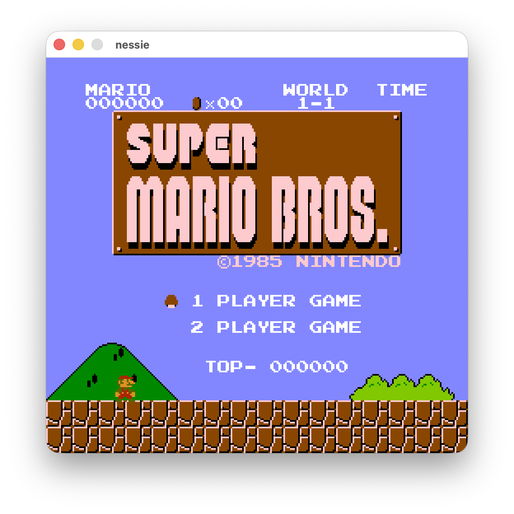
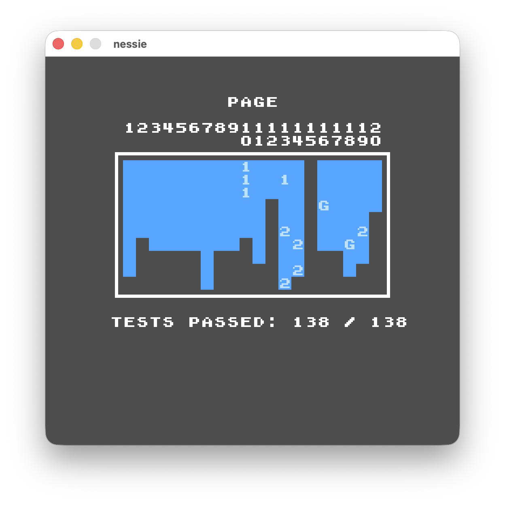

# nessie

Yet another NES emulator, a small project with two goals:

- learn a bit of Zig
- get it to pass [AccuracyCoin](https://github.com/100thCoin/AccuracyCoin) with disregard to quality/performance

<p align="center">
  
  
</p>

## Building & running

Requires Zig 0.17.0.

For the actual executable

```sh
zig build raylib --release=fast

# in the default zig-out/bin dir
./zig-out/bin/nessie-rl <path-to-.nes-file>
```

Running the AccuracyCoin harness (headless runner, reports test failures):

```sh
zig build accuracycoin
AccuracyCoin: 138/138 passed, 0 failed, 0 incomplete after 4670 polled frames
```

## Controls

| NES             | Keyboard                                            |
| --------------- | --------------------------------------------------- |
| A               | <kbd>X</kbd>                                        |
| B               | <kbd>Z</kbd>                                        |
| Select          | <kbd>Right Shift</kbd>                              |
| Start           | <kbd>Enter</kbd>                                    |
| D-pad           | <kbd>↑</kbd> <kbd>↓</kbd> <kbd>←</kbd> <kbd>→</kbd> |
| Pause emulation | <kbd>P</kbd>                                        |

## Notes

Main executable uses [Raylib](https://www.raylib.com/) for video/audio/input.

This project contains code generated via agentic coding, examples can be seen in:

- repetitive structural code (instruction tests in `system.zig`)
- dmc/ppu code, started from handwritten structure and later driven by an agent trying to pass AccuracyCoin tests

The general approach was starting by handwriting core parts (cpu/cart/instructions/bg rendering) and once there was a working base, using an agent to drive experimentation/debugging and fixing AccuracyCoin test cases.

## License

MIT
